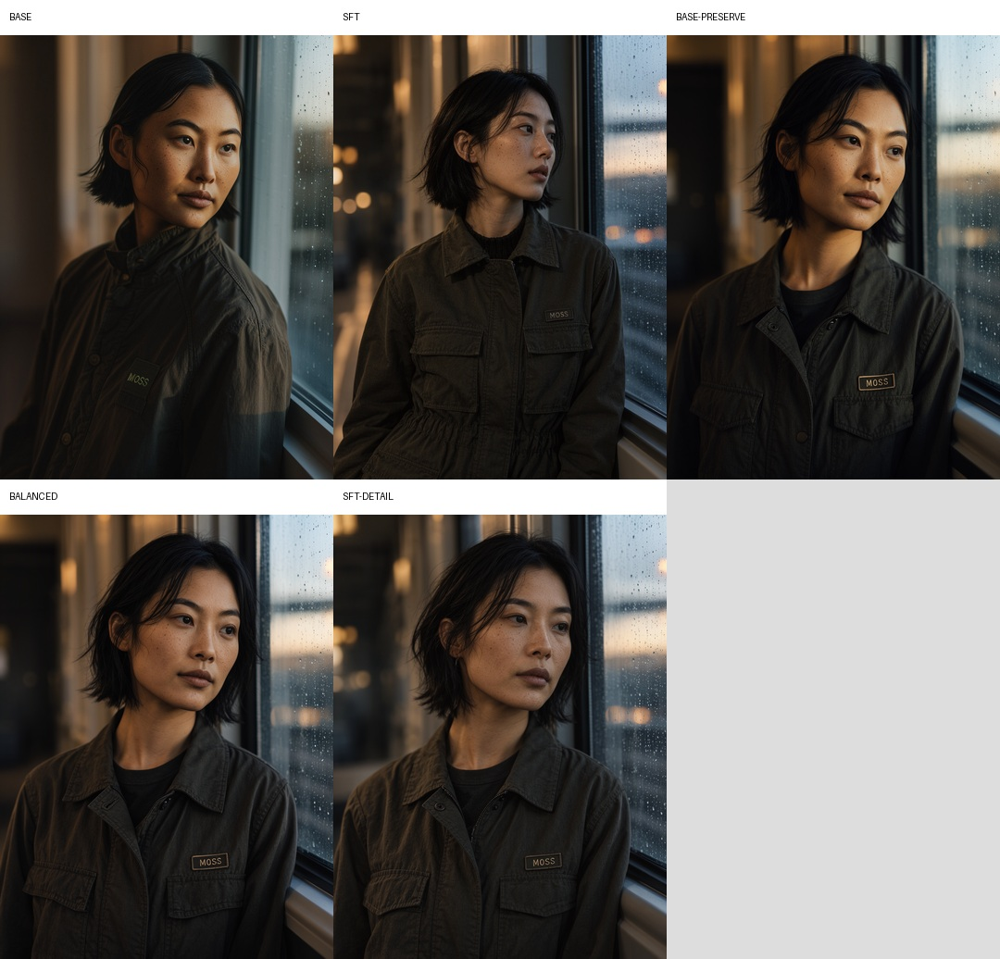
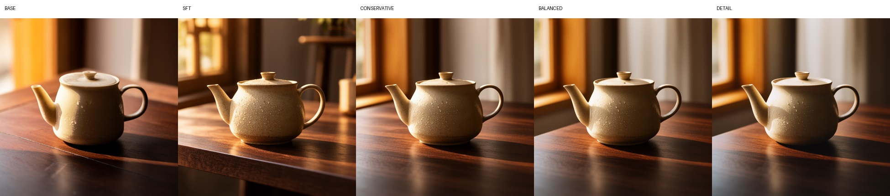
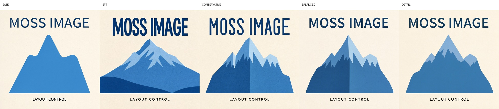
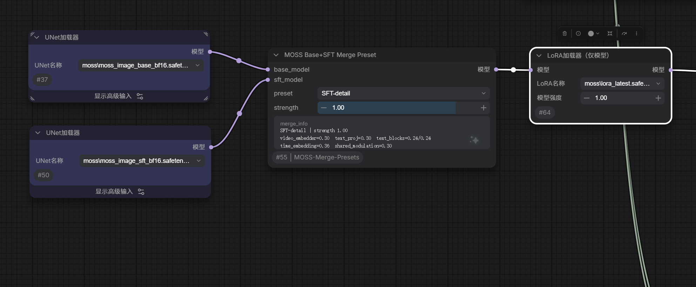

# ComfyUI MOSS Base+SFT Merge Presets

**English** | [简体中文](README_ZH.md)

[](https://github.com/comfyanonymous/ComfyUI)
[](https://github.com/OpenMOSS/MOSS-Image)
[](LICENSE)
A ComfyUI custom node for merging **MOSS-Image Base** and **SFT** with reproducible presets or full per-layer control.

The goal is to retain Base's composition and natural realism while selectively inheriting SFT's typography, material, and fine-detail strengths.

> Unofficial community project. Not affiliated with OpenMOSS, MOSI, or the ComfyUI project.

## Preview

The material and typography sheets show, from left to right: **Base**, **SFT**, **Base-preserve**, **Balanced**, and **SFT-detail**. The portrait sheet also includes **Balanced** at strengths **0.1** and **0.3**.

### Portrait



### Material and realism



### Typography and graphic detail



## Features

- One-click `Base-preserve`, `Balanced`, and `SFT-detail` presets.
- A `Custom` mode exposing all 51 merge components.
- Per-layer control over all 42 MOSS-Image DiT blocks.
- A live `merge_info` readout showing effective weights after `strength` scaling.
- No extra Python dependencies beyond ComfyUI itself.
- Native **int8c / convrot Base + SFT** merging support.
- Compatible with the native ComfyUI MOSS-Image loader and sampling chain.
- Pairs with ComfyUI's built-in **ModelSave** and model-only LoRA loader nodes.

## Requirements

- ComfyUI `0.42.0` or newer is recommended.
- Official MOSS-Image Base and SFT weights:
  - [MOSS-Image-Base](https://huggingface.co/OpenMOSS-Team/MOSS-Image-Base)
  - [MOSS-Image-SFT](https://huggingface.co/OpenMOSS-Team/MOSS-Image-SFT)
- int8c / convrot quantized Base and SFT diffusion models are supported.
- A ComfyUI-compatible MOSS-Image text encoder and Flux.2 VAE.
- Tested with ComfyUI 0.42.0 on Windows and an RTX 5090.

### int8c / convrot compatibility

The node supports **int8c Base + int8c SFT** merging:

- Both `base_model` and `sft_model` may be int8c / convrot models.
- ComfyUI's native quantized patch path dequantizes SFT weights, performs the component-wise interpolation, and requantizes using the Base model's layout.
- The output keeps `base_model`'s int8c quantization layout instead of falling back to BF16.
- Quantization metadata such as `weight_scale` and `comfy_quant` is not treated as ordinary mergeable weights; scales are regenerated during requantization.
- The first patch application can be slower than a BF16 merge because quantized weights are dequantized on demand.

## Installation

Clone this repository into your ComfyUI custom nodes directory:

```bash
cd ComfyUI/custom_nodes
git clone https://github.com/slmonker/ComfyUI-MOSS-Merge-Presets.git
```

Restart ComfyUI after installation.

## Example Workflow

[**Download `moss-merge-model.json`**](example_workflows/moss-merge-model.json)

Drag the downloaded JSON file onto the ComfyUI canvas to import it. The example demonstrates:

- loading MOSS-Image Base and SFT diffusion models;
- merging them with **MOSS Base+SFT Merge Preset** using `Balanced` and `strength = 1.0`;
- optional local prompt expansion through **MOSS Prompt Enhancer**;
- sampling the merged model and saving the generated image.

> [!IMPORTANT]
> The example workflow uses the **MOSS Prompt Enhancer** node (`MOSSPromptEnhancerLocal`) from **[ComfyUI-MOSS-PromptEnhancer](https://github.com/slmonker/ComfyUI-MOSS-PromptEnhancer)**. Install that companion project before importing the workflow. If you do not need prompt expansion, remove or bypass the node and connect your positive prompt directly to the sampler.

Reselect the Base, SFT, text encoder, and VAE files in their loader nodes if your local filenames differ from the example.

## Usage

1. Add two diffusion model loaders:
   - one for MOSS-Image Base;
   - one for MOSS-Image SFT.
2. Add **MOSS Base+SFT Merge Preset** from `model/merging/moss`.
   - Double-click the search result in the node library to add it. A single click only previews the node in current ComfyUI versions.
3. Connect:
   - Base loader → `base_model`
   - SFT loader → `sft_model`
4. Connect the merged `MODEL` output into your sampling chain:

```text
Base MODEL ─┐
            ├─ MOSS Base+SFT Merge Preset ─ ModelSamplingSD3 ─ SkipLayerGuidanceDiTSimple ─ KSampler
SFT MODEL ──┘
```

5. Start with `Balanced` and `strength = 1.0`.

## Saving the merged model

This package does not need a separate save node. Add ComfyUI's built-in **ModelSave** node (shown as **Save Model** in some locales, category `model/merging`) after the merge node, then connect the merged `MODEL` to its `model` input:

```text
Base MODEL ─┐
            ├─ MOSS Base+SFT Merge Preset ─┬─ ModelSave
SFT MODEL ──┘                              └─ ModelSamplingSD3 → SkipLayerGuidanceDiTSimple → KSampler
```

Set `filename_prefix` without an extension, for example `diffusion_models/moss_balanced_s100`. ComfyUI saves the file under `ComfyUI/output/diffusion_models/` using its normal counter-based naming. To load it later with **Load Diffusion Model**, move the finished `.safetensors` file into `ComfyUI/models/diffusion_models/` (or the equivalent configured model directory).

**ModelSave** is an output node, so it has no `MODEL` output. Branch it from the merge output while the sampling chain continues separately. The saved file contains the diffusion model produced by the merge node; it does not include the text encoder or VAE.

## Using LoRA after the merge

Add ComfyUI's **Load LoRA** node (`LoraLoaderModelOnly`, category `model/loaders`) after **MOSS Base+SFT Merge Preset**:

```text
Base MODEL ─┐
            ├─ MOSS Base+SFT Merge Preset ─ Load LoRA ─ ModelSamplingSD3 → SkipLayerGuidanceDiTSimple → KSampler
SFT MODEL ──┘
```

Connect the merged `MODEL` to the LoRA node's `model` input, select the LoRA file, and set `strength_model`. The LoRA is applied to the merged model at inference time; multiple Load LoRA nodes can be chained. If you also want to save the Base+SFT merge, branch **ModelSave** directly from the merge output as shown above so later LoRA changes stay independent.



## Presets

Merge weights use `0 = Base` and `1 = SFT`.

| Component | Base-preserve | Balanced | SFT-detail |
|---|---:|---:|---:|
| `video_embedder` | 0.12 | 0.20 | 0.30 |
| `text_embedder.proj` | 0.12 | 0.20 | 0.30 |
| `text_embedder.blocks.0` | 0.10 | 0.16 | 0.24 |
| `text_embedder.blocks.1` | 0.10 | 0.16 | 0.24 |
| `time_embedding` | 0.14 | 0.24 | 0.36 |
| `shared_block_modulation` | 0.12 | 0.20 | 0.30 |
| `layers.0-7` | 0.08 | 0.15 | 0.25 |
| `layers.8-13` | 0.12 | 0.20 | 0.32 |
| `layers.14-21` | 0.18 | 0.30 | 0.50 |
| `layers.22-29` | 0.28 | 0.45 | 0.65 |
| `layers.30-35` | 0.42 | 0.60 | 0.80 |
| `layers.36-41` | 0.52 | 0.72 | 0.90 |
| `final_norm_video` | 0.12 | 0.20 | 0.30 |
| `final_linear_video` | 0.25 | 0.35 | 0.50 |
| `video_head_modulation` | 0.12 | 0.20 | 0.30 |

### `strength`

`strength` scales every component uniformly:

- `0.0` = pure Base
- `1.0` = selected preset
- values above `1.0` amplify the preset until each component reaches `1.0`n
Note: because each component is clamped at `1.0`, `1.25` is not a uniform 25% increase. `SFT-detail` at `1.25` is still a blend, not pure SFT.

## Custom Mode

Select `Custom` to reveal all 51 editable components:

- `m_video_embedder`
- `m_text_proj`
- `m_text_block0`
- `m_text_block1`
- `m_time`
- `m_shared`
- `m_L00` through `m_L41`
- `m_final_norm`
- `m_linear`
- `m_head`

Custom mode starts from the `Balanced` values. The `merge_info` field updates with the effective per-layer values.

### Layer guidance

The following is based on controlled Base/SFT merge experiments, not an official MOSS training claim:

| Range | Main influence |
|---|---|
| `text_embedder.*` | Prompt semantics and text-conditioning projection |
| `time_embedding` | Global contrast, lighting, and timestep response |
| `layers.0-13` | Subject placement, overall composition, and broad layout |
| `layers.14-27` | Typography hierarchy, structured layout, and mid-level detail |
| `layers.28-41` | Material texture, fine detail, and finish |
| `final_*` / `video_head_modulation` | Output mapping, color, sharpness, and final look |

To preserve Base composition, keep the early layers low. To add more SFT detail, increase the late layers first, then the middle layers.

## Recommended Sampling

The presets were tested with the native ComfyUI MOSS-Image pipeline:

- `ModelSamplingSD3 shift`: `5.0`
- `CFG`: `3.5`
- Sampler: `er_sde`
- Scheduler: `simple`
- Steps: `24` for drafts, `40-50` for final images
- `SkipLayerGuidanceDiTSimple`:
  - `single_layers`: `22`
  - `start_percent`: `0.0`
  - `end_percent`: `0.5`

The official Python/Diffusers pipeline can also be used with its defaults: 50 steps, Euler, CFG 3.0, shift 5, and negative-branch layer skip 22.

## Test Prompts

A set of portrait, product, typography, interior, anime, and material tests is available in [TEST_PROMPTS.md](TEST_PROMPTS.md).

Recommended comparison workflow:

1. Keep the same seed, prompt, dimensions, and sampler settings.
2. Generate `Base-preserve`, `Balanced`, and `SFT-detail`.
3. Compare composition, skin/material texture, text accuracy, and fine detail.
4. Test at least two or three seeds because composition can shift with merged weights.

Common negative prompt:

```text
nsfw, worst quality, bad anatomy, watermark, jpeg artifact
```

## Troubleshooting

### The node shows a preview but is not added

Double-click the node in the ComfyUI node library. Single-click currently previews the node in some ComfyUI frontend versions.

### Preset values are hidden after switching modes

This is expected. Presets hide the 51 custom sliders and show all effective values in `merge_info`. Select `Custom` to edit them.

### Merged images drift too far toward SFT

- Lower `strength`.
- Switch to `Base-preserve`.
- Reduce `layers.0-13` and `time_embedding` first.
- Test another seed.

### Text or fine detail is still weak

- Raise `layers.14-29`.
- Then raise `layers.30-41`.
- Use `SFT-detail` as the starting point.

## Limitations

- Linear weight merging is not equivalent to orthogonal layer or activation control.
- Composition can remain seed-sensitive.
- SFT training details are not fully public, so the layer guidance is empirical.
- The project does not include model weights.

## License

MIT. See [LICENSE](LICENSE).

## Acknowledgements

- [OpenMOSS / MOSS-Image](https://github.com/OpenMOSS/MOSS-Image)
- [ComfyUI](https://github.com/comfyanonymous/ComfyUI)
- [ComfyUI-MOSS-PromptEnhancer](https://github.com/slmonker/ComfyUI-MOSS-PromptEnhancer)
- The ComfyUI model-merging API and MOSS-Image community integrations

## Changelog

See [CHANGELOG.md](CHANGELOG.md).
